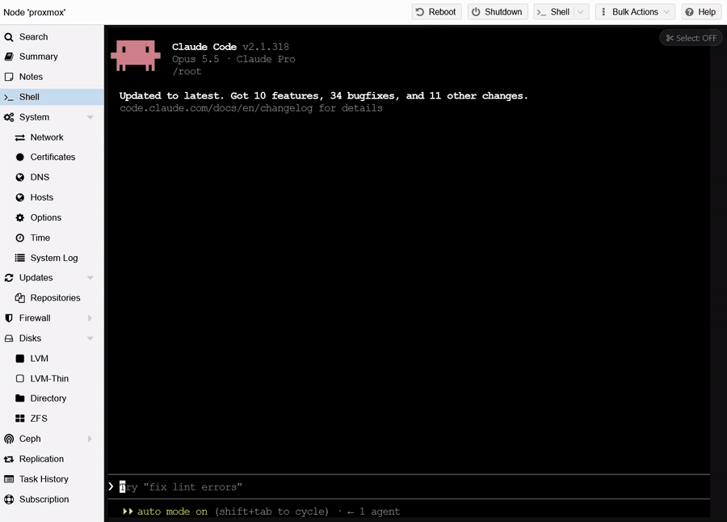
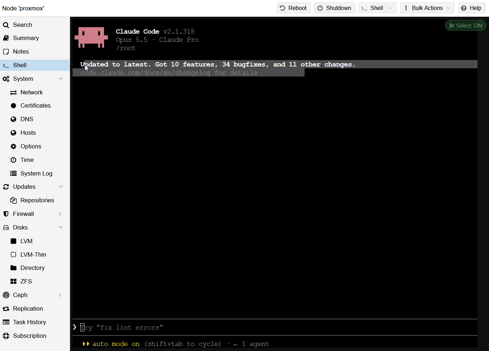
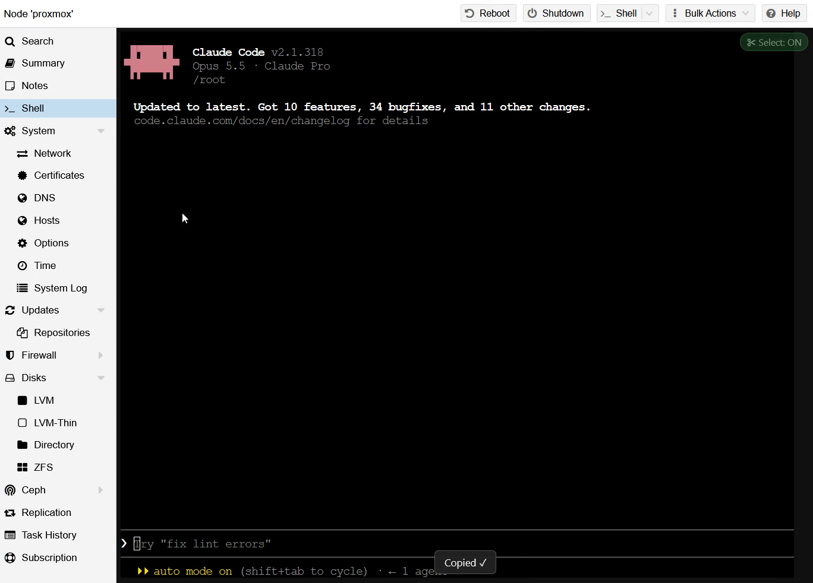
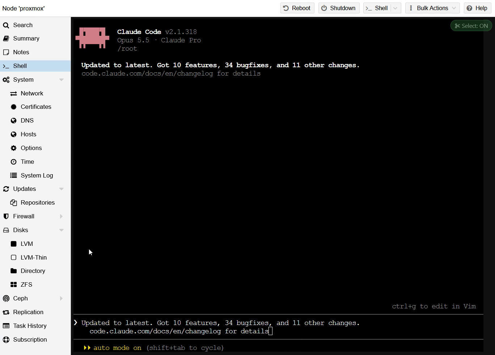

# ✂ Proxmox Terminal Select

**Select and copy text in the Proxmox web terminal, even when an app like Claude Code, htop or vim captures the mouse.**

## The problem

When you run a terminal app such as **Claude Code**, htop, vim or mc in the Proxmox web console (xterm.js),
the app turns on **mouse tracking**. From then on, every click and drag is sent to the app instead of
selecting text, so you **can't select or copy anything** from the terminal. You end up retyping output by hand.

## The fix

This extension gives you normal text selection back in the Proxmox xterm.js console:

| Action | Effect |
|---|---|
| **Click-drag** in the terminal | Selects text and **copies it to the clipboard automatically** ("Copied ✓" toast) |
| Double-click / triple-click | Selects a word / a line |
| **Alt+Shift+S** | Opens the whole terminal content (scrollback included) as plain, freely selectable text. Esc to close |
| **Alt+Shift+F** or click the `✂ Select` badge (top-right) | Toggles the feature (OFF = the mouse goes back to the app) |

| 1. Click-drag to select | 2. Copied automatically | 3. Paste anywhere |
|---|---|---|
|  |  |  |

> ⚠️ Works with the Proxmox **xterm.js** console (`>_ Console` ▸ `xterm.js`, or the node `Shell`).
> The noVNC console is an image, so there is no text to select there.

## Install

**Zen / Firefox** — click **[proxmox-terminal-select.xpi](https://github.com/MaxBernede/proxmox-terminal-select/releases/latest/download/proxmox-terminal-select.xpi)** ▸ **Add**
(or download it, then `about:addons` ▸ ⚙ ▸ **Install Add-on From File…**).
The extension is signed by Mozilla, so it stays installed across restarts and updates automatically from this repo (`updates.json`).

**Chrome / Edge / Brave** — download **[proxmox-terminal-select.zip](https://github.com/MaxBernede/proxmox-terminal-select/releases/latest/download/proxmox-terminal-select.zip)**,
extract it, then `chrome://extensions` ▸ enable **Developer mode** ▸ **Load unpacked** ▸ pick the folder.

**Userscript** — install **[Violentmonkey](https://addons.mozilla.org/firefox/addon/violentmonkey/)** (or Tampermonkey),
then click **[proxmox-terminal-select.user.js](https://raw.githubusercontent.com/MaxBernede/proxmox-terminal-select/main/proxmox-terminal-select.user.js)** ▸ **Install**.

Then reload the Proxmox console tab: the `✂ Select: ON` badge appears in the top-right corner.

## How it works

xterm.js lets you select text while **Shift** is held, even when an app captures the mouse.
The extension intercepts mouse clicks inside the terminal and forwards them to xterm.js as if Shift were held.
Hover and scroll events still go to the app, so it keeps working normally.
Plain-text mode reads the xterm.js buffer directly (`term.buffer.active`).

**Privacy:** nothing is collected or sent anywhere, everything runs locally in the page.
On pages without an xterm.js terminal the script does nothing and stops.

## Build & release

The source is `content.js`. `./build.ps1` generates `proxmox-terminal-select.user.js` (committed),
plus the unsigned `.xpi` and the `.zip` (Chrome).

For a new Zen/Firefox version: bump `version` in `manifest.json`, run `./build.ps1`, then sign it with
`npx web-ext sign --channel=unlisted --source-dir <folder with manifest.json + content.js>`
(AMO API keys in `WEB_EXT_API_KEY` / `WEB_EXT_API_SECRET`). Attach the signed `.xpi` to a GitHub release
as `proxmox-terminal-select.xpi` and add the version to `updates.json`.

## License

MIT
